<p align="center">
  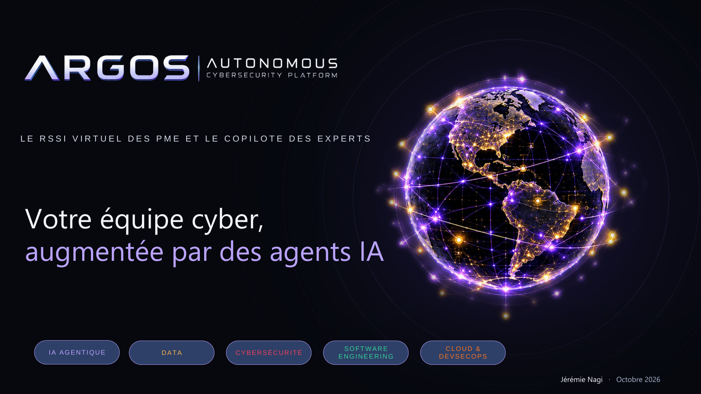
</p>

<h1 align="center">ARGOS</h1>

<p align="center">
  <b>A virtual CISO for SMEs and a copilot for security experts.</b><br>
  OSINT, offensive and defensive security in one platform, run by AI agents under strict human control.
</p>

<p align="center">
  
  
  
  
  
</p>

<p align="center">
  <a href="docs/presentation/ARGOS-presentation.pdf"><b>Project presentation (PDF, 12 slides, in French)</b></a> ·
  <a href="#what-works-today">What works today</a> ·
  <a href="#architecture">Architecture</a> ·
  <a href="#getting-started">Getting started</a>
</p>

---

## Why ARGOS

Most small companies have no security team and almost no security budget, while attacks are getting cheaper to run with AI. Only 20% of French SMEs say they are prepared for cyber risk, and 89% of companies with 10 to 49 employees employ no IT specialist (sources on slide 3).

ARGOS answers with one platform covering four areas — **OSINT**, **offensive security**, **defensive security / GRC**, and **continuous validation** — for three users:

| SME | Managed service provider | Security expert |
| --- | --- | --- |
| *"I want to know how to protect myself at the lowest cost."* | *"I want to sell and strengthen my security services."* | *"I want to automate the repetitive work and keep technical control."* |

The rule at every stage: **the AI assists, deterministic code decides what is allowed, and a human approves.** Core capabilities keep working without an LLM.

<p align="center">
  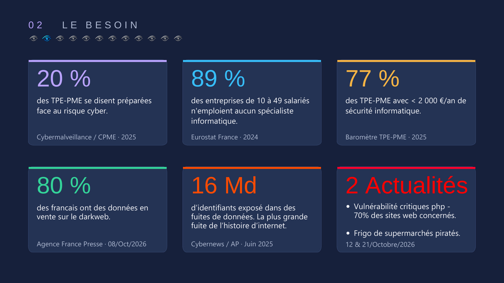
  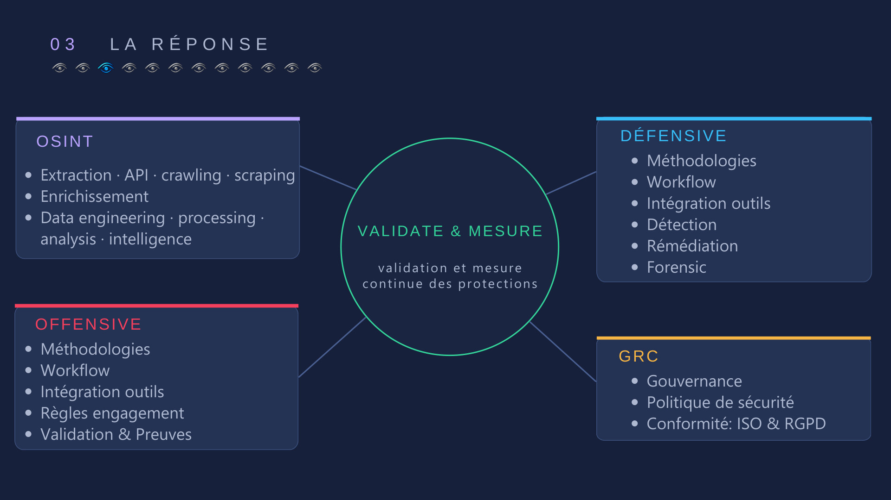
</p>

## What works today

ARGOS is under active development. Each capability below is implemented and covered by tests; the rest is designed and tracked in the [roadmap](#roadmap).

### OSINT — company discovery

- Bounded searches in INSEE's public **SIRENE** database, from a command-line tool.
- **Traceability:** every data point keeps its source and collection date, in SQLite.
- Readable **Markdown reports** stating the scope, the coverage and whether a search was partial.

### ATTACK P1 — authorized reconnaissance engine

A pentest engine where ARGOS, not the operator, chooses and runs bounded Nmap scans. Safety is enforced by code, not by prompts:

- **Missions with a signed grant:** a mission has a validity window, explicit target scope and allowed actions. The grant is signed with **Ed25519** and verified before submission, before launch, and about every 250 ms while the scan runs. Revocation or expiry stops the scan.
- **No shell, no free-form commands:** Nmap options come from an allowlist and run as argument arrays, with time, concurrency and output-size limits.
- **Evidence you can verify:** command arguments, timestamps, exit status and raw XML are stored with **SHA-256** hashes. Follow-up steps refuse to run on missing or altered evidence.
- **Adaptive reconnaissance:** TCP discovery of common ports, then service identification on the open ports only, through the same authorization gateway. At most two phases.
- **Honest reports:** open ports are observations, never presented as confirmed vulnerabilities. Suggested investigations are hints, not executable actions.
- **Audit trail** of every policy decision and job event.

No exploitation, credential attacks or intrusive scripts are in scope. The engine is a backend library for now: it is not yet exposed through the API or the web interface. Its [known limitations](docs/product/PENTEST_P135_HARDENING.md#security-limitations-not-production-ready) are documented, and it is not production-ready.

### Engineering

- **180+ Python tests** (pytest) with synthetic processes and fixtures, no real network scans; Ruff linting; GitHub Actions CI on Ubuntu.
- **Web foundation:** a FastAPI API (health endpoint) and a React / TypeScript / Vite application, tested with Vitest and Playwright.
- Modular monolith ([ADR 0001](docs/architecture/adr/0001-modular-monolith.md)), dependencies locked with `uv`.

## Architecture

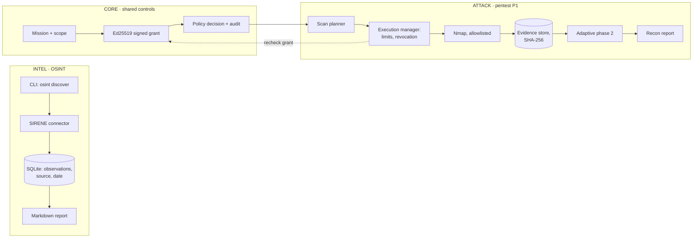

### The agentic core (designed)

A reliable agent for long security missions needs more than a prompt. The [agentic architecture](docs/architecture/AGENTIC_CORE.md) defines ten subsystems — agent loop, planning, context engine, state management, memory, tool runtime, multi-agent orchestration, multi-surface execution, learning engine, safety and evaluation. Agent V0 is being specified on the `feat/agent-foundation` branch.

<p align="center">
  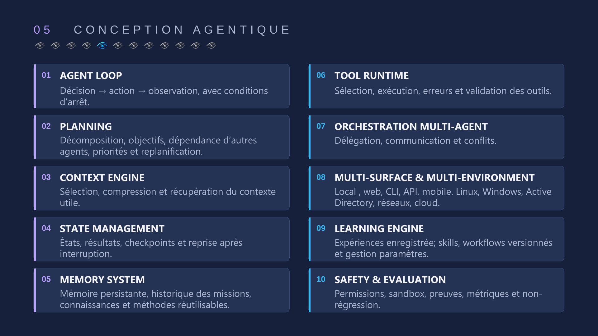
  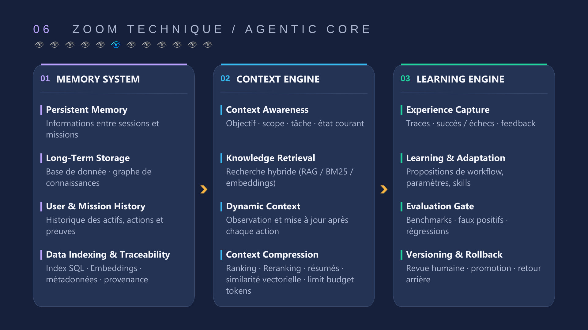
</p>

## Roadmap

<p align="center">
  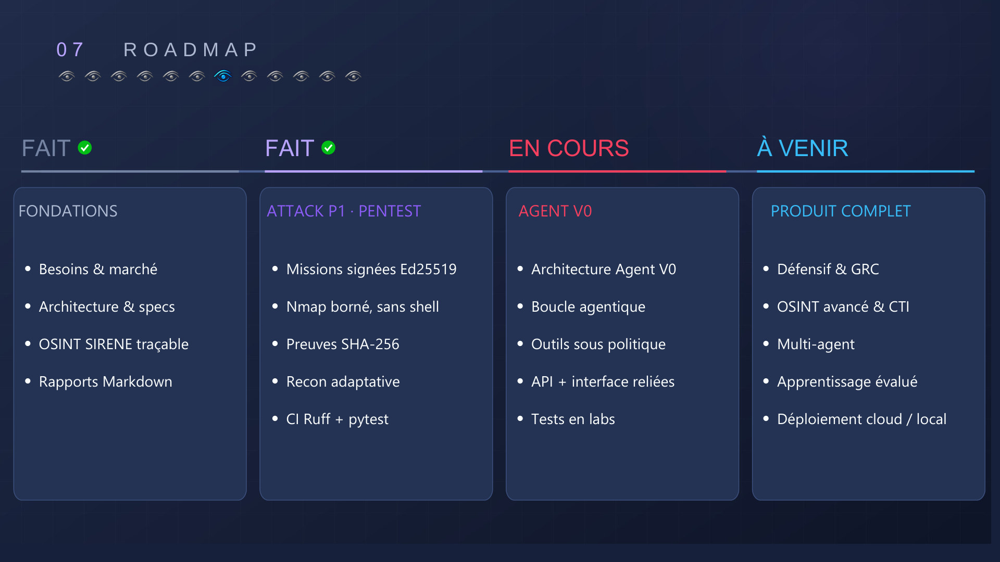
</p>

| Stage | Status | Content |
| --- | --- | --- |
| Foundations | Done | Market research, architecture, traceable SIRENE OSINT, reports |
| ATTACK P1 | Done | Signed missions, bounded Nmap execution, evidence, adaptive recon, CI |
| Agent V0 | In progress | Agent loop, tools under policy, API and interface connected to the backend, lab tests |
| Full product | Next | Defensive and GRC, advanced OSINT and threat intelligence, multi-agent, evaluated learning, cloud or local deployment |

## The presentation

The [full deck (PDF, in French)](docs/presentation/ARGOS-presentation.pdf) explains the vision, the agentic design, the market and the business model.

<details>
<summary><b>Browse all 12 slides</b></summary>
<br>

| | |
| --- | --- |
|  | 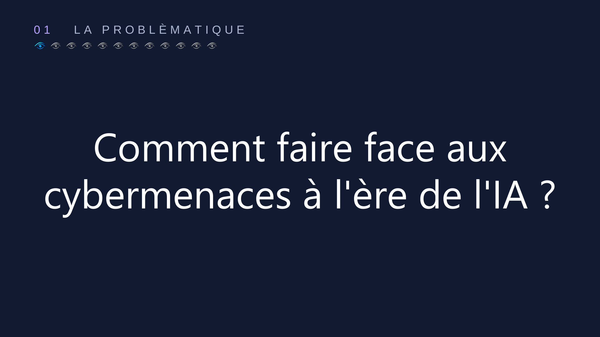 |
|  |  |
| 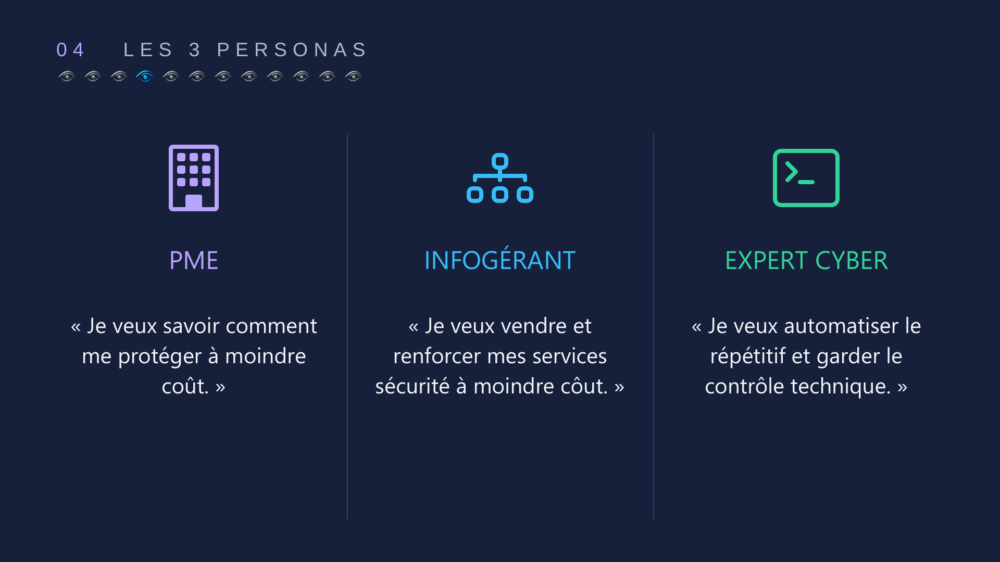 |  |
|  |  |
| 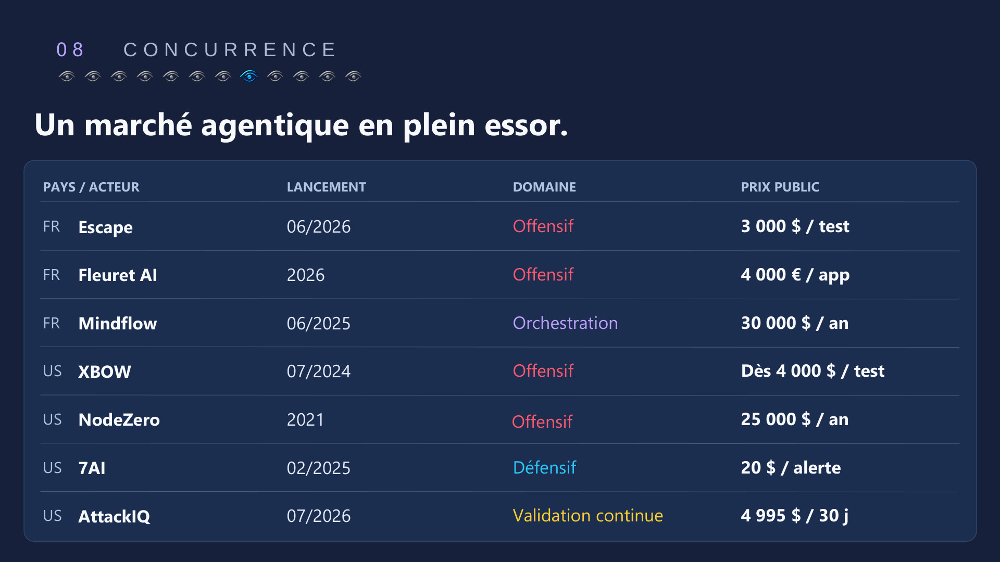 | 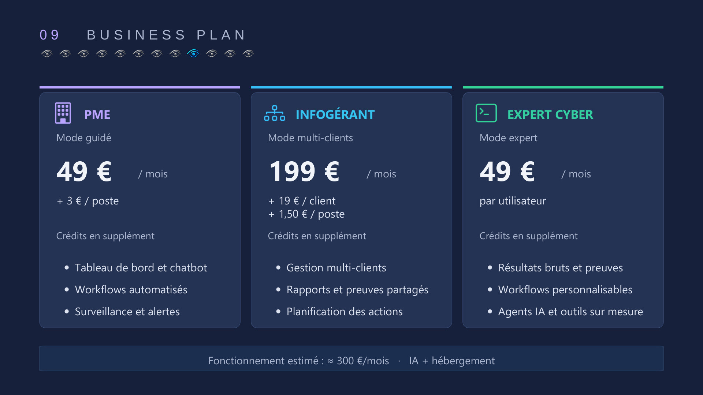 |
| 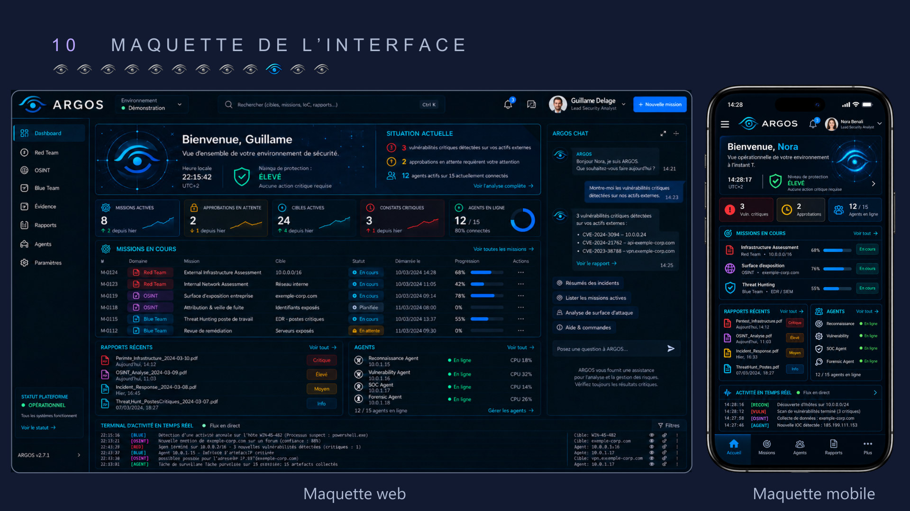 | 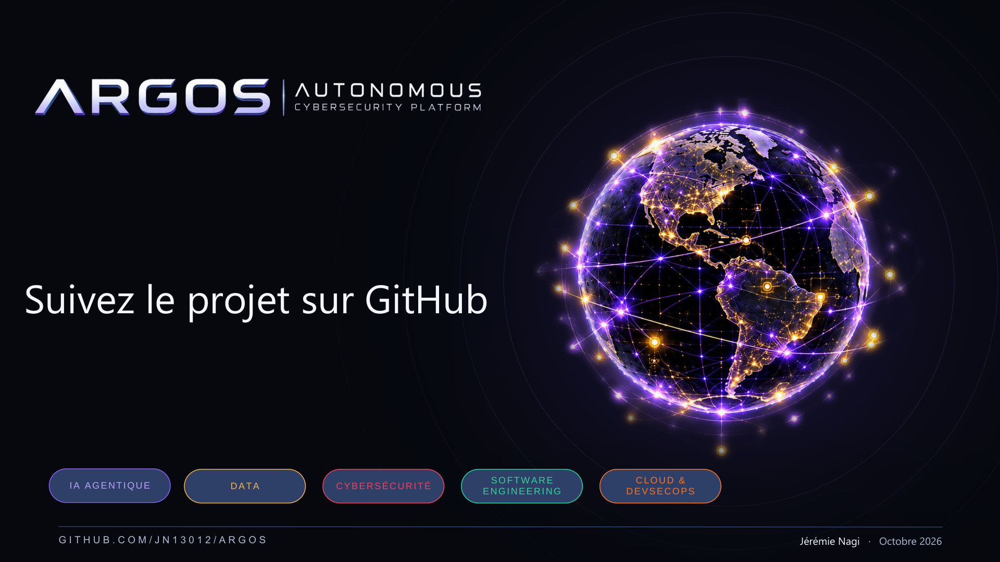 |

The interface on slide 11 is a design mock-up; the web application in this repository does not show these screens yet.

</details>

## Tech stack

| Area | Tools |
| --- | --- |
| Backend | Python 3.12, FastAPI, Pydantic, httpx, SQLite, `cryptography` (Ed25519) |
| Security tooling | Nmap (allowlisted options, XML parsing) |
| Frontend | React, TypeScript, Vite, Vitest, Playwright |
| Quality | pytest, Ruff, ESLint, GitHub Actions, `uv` lockfile |

## Getting started

Requirements: Python 3.12 and [uv](https://docs.astral.sh/uv/). Node.js 24 for the frontend.

```bash
uv sync --locked --group dev
uv run pytest -q
uv run ruff check argos/backend/core argos/backend/attack tests/
```

### OSINT discovery

Create a local `.env` from `.env.example` and fill in `INSEE_API_KEY` privately (never commit it; an existing environment variable takes priority over the file).

```bash
uv run python -m argos osint discover --help
```

`discover` takes an activity, a location and an explicit SIRENE query; `--name` sets a readable folder name and `--max-pages` bounds the collection.

Each run stores observations in `.argos/osint/argos.sqlite3` and writes a numbered report under `outputs/sirene/RESEARCH_NAME/rapport-001.md`. Reports list the scope, coverage, source, query and establishments; partial searches are marked as non-exhaustive. Both folders are excluded from Git.

Export a saved search again, without an API call or key:

```bash
uv run python -m argos osint report --search-id SEARCH_UUID --name garages-marseille
```

### Web application

```bash
# Terminal 1: API on http://localhost:8000 (GET /api/v1/health)
bash scripts/dev-api.sh

# Terminal 2: web app on http://localhost:8013, proxies /api
bash argos/frontend/start-local.sh
```

Frontend checks run from `argos/frontend` with `npm run check`, and end-to-end tests with `npm run test:e2e`. See the [frontend instructions](argos/frontend/README.md).

## Repository layout

```text
argos/
  backend/
    core/          missions, scope, policy, signed approvals, audit
    attack/pentest planner, execution manager, Nmap runner and parser, evidence, reports
    intel/osint    SIRENE connector, discovery, storage, reports
    api/           FastAPI application
  frontend/        React / TypeScript / Vite application
docs/
  product/         vision, scope, roadmap, pentest increments
  architecture/    architecture, agentic core, ADRs
  presentation/    project deck (PDF) and slide images
tests/             pytest suite
```

## Documentation

- Product: [Vision](docs/product/VISION.md) · [Scope](docs/product/SCOPE.md) · [Project framework](docs/product/CADRE.md) · [Roadmap](docs/product/ROADMAP.md) · [References](docs/product/REFERENCES.md)
- OSINT: [OSINT design](docs/product/OSINT.md)
- Pentest: [MVP plan](docs/product/PENTEST_MVP.md) · [Signed approvals](docs/product/PENTEST_P131_ED25519.md) · [Execution](docs/product/PENTEST_P132_EXECUTION.md) · [Evidence](docs/product/PENTEST_P133_EVIDENCE.md) · [Adaptive recon](docs/product/PENTEST_P134_ADAPTIVE.md) · [Hardening and limits](docs/product/PENTEST_P135_HARDENING.md)
- Architecture: [Architecture](docs/architecture/ARCHITECTURE.md) · [Agentic architecture](docs/architecture/AGENTIC_CORE.md) · [Repository architecture](docs/architecture/README.md)
- Frontend: [Frontend plan](docs/development/frontend/PLAN_FRONTEND.md)

## Responsible use

ARGOS only scans targets covered by an explicit, signed and unexpired mission. Use it on systems you own or are authorized in writing to test.

## Author

**Jérémie Nagi** — Master of Science student at Epitech Marseille, working on AI and cybersecurity.
[GitHub](https://github.com/JN13012)
