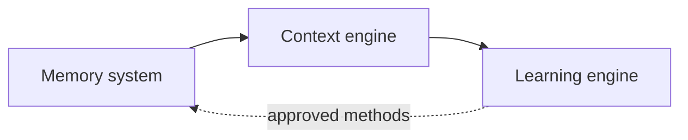

# Agentic architecture

**This is a design document.** No agent runs in Argos today: the code is the OSINT foundation described in the README. The closest existing brick is the storage of observations with their source and date, which the memory and evidence layers will build on.

A reliable agent is more than a prompt. For long cybersecurity missions, it needs these subsystems to be designed, integrated and tested.

## Subsystems

| # | Subsystem | Role | Status |
| --- | --- | --- | --- |
| 1 | Agent loop | Decision, action, observation, with stop conditions | Designed |
| 2 | Planning | Breaking down objectives, dependencies between agents, priorities, replanning | Designed |
| 3 | Context engine | Selecting, compressing and retrieving useful context | Designed |
| 4 | State management | States, results, checkpoints, resuming after an interruption | Designed |
| 5 | Memory system | Persistent memory, mission history, knowledge and reusable methods | Designed |
| 6 | Tool runtime | Selecting and running tools, validating them, handling errors | Designed |
| 7 | Multi-agent orchestration | Delegation, communication, conflicts | Designed |
| 8 | Multi-surface and multi-environment | Local, web, CLI, API, mobile; Linux, Windows, Active Directory, networks, cloud | Designed |
| 9 | Learning engine | Recorded experience, versioned skills and workflows, parameter management | Designed |
| 10 | Safety and evaluation | Permissions, sandbox, evidence, metrics, non-regression | Designed |

## Memory, context and learning

| Memory system | Context engine | Learning engine |
| --- | --- | --- |
| **Persistent memory:** information across sessions and missions | **Context awareness:** objective, scope, task, current state | **Experience capture:** traces, successes and failures, feedback |
| **Long-term storage:** database, knowledge graph | **Knowledge retrieval:** hybrid search (RAG, BM25, embeddings) | **Learning and adaptation:** proposed workflows, parameters and skills |
| **User and mission history:** assets, actions and evidence | **Dynamic context:** observed and updated after each action | **Evaluation gate:** benchmarks, false positives, regressions |
| **Indexing and traceability:** SQL index, embeddings, metadata, provenance | **Context compression:** ranking, reranking, summaries, vector similarity, token budget | **Versioning and rollback:** human review, promotion, rollback |

## Rules specific to a security agent

- **Authorization lives outside the model.** The mandate and the scope of an audit are checked by code, so no answer from the model can widen them.
- **Whatever comes from a target is untrusted.** A page or a file read during an audit may contain a prompt injection, so it is treated as data and never as instructions.
- **A finding needs evidence.** The evidence is recorded by the platform, not written by the model.
- **Learning goes through a gate.** A new method is proposed, evaluated and reviewed by a human before it is promoted.
